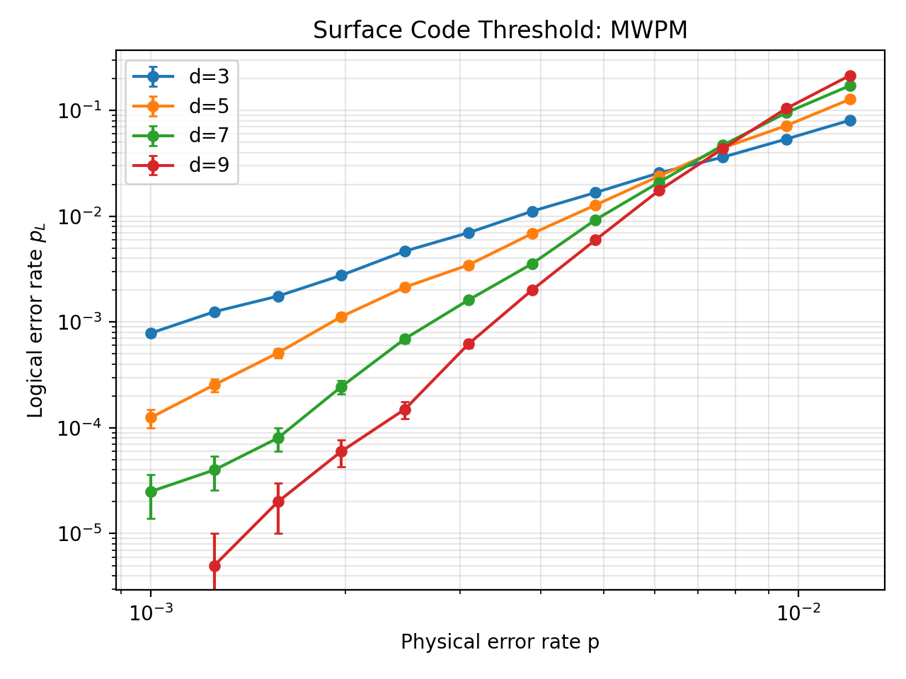
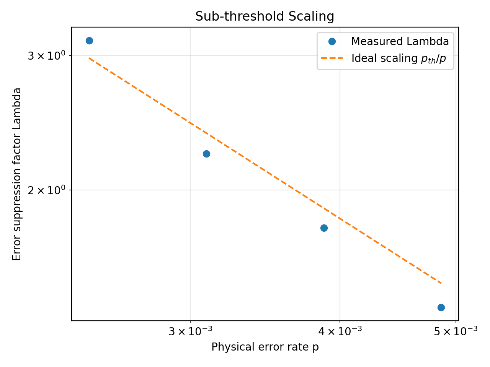
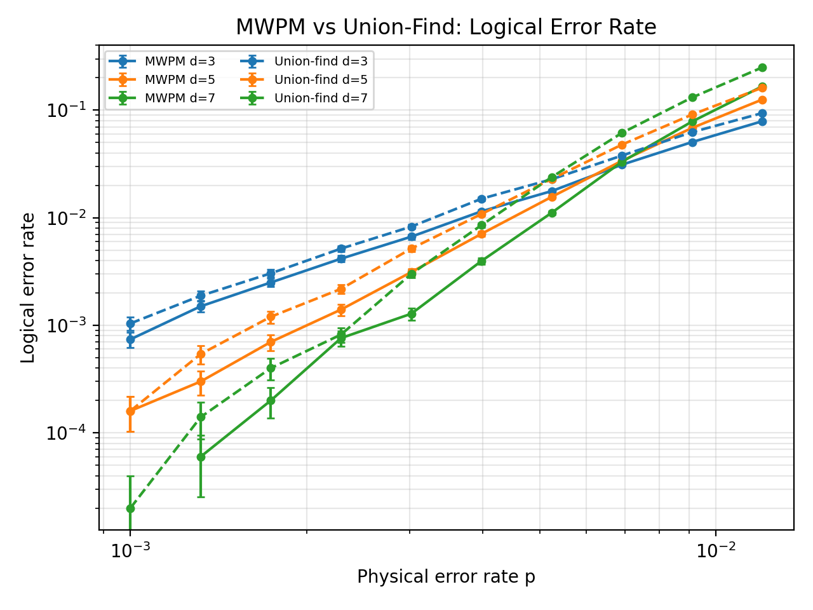
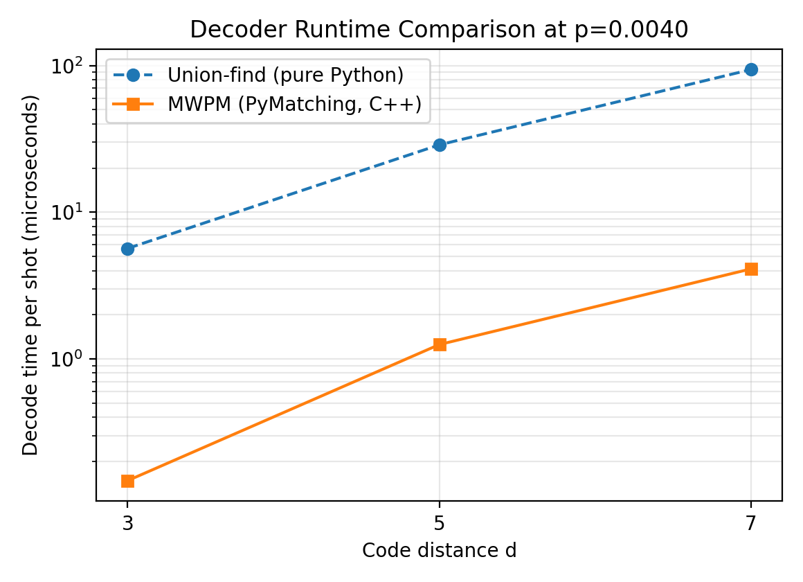

# Surface code decoders: MWPM vs a from-scratch union-find decoder

A short, self-directed project on quantum error correction. I simulate the rotated surface code under
circuit-level depolarizing noise, estimate the error threshold with minimum-weight perfect matching (MWPM), implement a
**union-find decoder from scratch**, and compare the two decoders on identical samples.

## Headline results

| Quantity | Result |
|---|---|
| MWPM threshold, full sweep (d = 3, 5, 7, 9; pairwise curve crossings) | **≈ 0.69 %** (spread of crossings ± 0.07 %) |
| MWPM threshold from sub-threshold scaling fit | ≈ 0.73 % |
| MWPM threshold, paired comparison run (d = 3, 5, 7) | ≈ 0.71 % |
| Union-find threshold, paired comparison run (d = 3, 5, 7) | **≈ 0.51 %** (about 27 % below MWPM) |
| Union-find logical error rate at p ≈ 0.4 %, d = 7 | about twice MWPM's |

The ± values are the spread between pairwise crossings (d = 3 vs 5, 5 vs 7, ...), not statistical confidence intervals.


*Logical error rate over d rounds. Points with zero observed errors are omitted; error bars are binomial standard errors.*

## Method

- **Code and noise.** Rotated surface code Z-memory experiment generated with [Stim](https://github.com/quantumlib/Stim),
  `rounds = d`. Depolarizing noise of strength `p` after Clifford gates and on data qubits before each round, plus
  reset and measurement flips of probability `p`.
- **Decoding graph.** Stim's detector error model (decomposed into graphlike errors) is converted to a matching graph:
  detectors are nodes, error mechanisms are edges, plus one virtual boundary node.
- **MWPM.** [PyMatching](https://github.com/oscarhiggott/PyMatching), with edge weights `log((1-p_e)/p_e)`.
- **Union-find (my implementation, `src/union_find.py`).** Delfosse-Nickerson: odd clusters grow by half an edge,
  fully grown edges merge clusters (union-find with small-to-large merging), clusters touching the boundary are neutral,
  and a peeling step on a spanning forest produces the correction. Growth ignores edge weights.
- **Threshold.** Crossing points of consecutive-distance curves in log-log space, averaged; the spread is quoted as the
  uncertainty. Sub-threshold behaviour is checked through the suppression factor Λ(p), with p_L ∝ Λ^-(d+1)/2.

## Results

### 1. MWPM threshold and sub-threshold scaling
Below threshold the logical error rate falls with distance; above it, it rises. Pairwise crossings drift upward with d
(finite-size effects), which is why I quote a spread rather than a single sharp value.


*Dashed line is p_th/p using the crossing-based p_th. Measured Λ drops below it near threshold, where the asymptotic
scaling is less accurate. Only points with at least 20 logical errors are used.*

### 2. MWPM vs union-find (paired samples)
Both decoders decode exactly the same detection events.


*Solid: MWPM. Dashed: union-find. Points with very few errors (low p, d = 7) have large relative uncertainty.*

The thresholds are about **0.71 % (MWPM)** and **0.51 % (union-find)**. Union-find is less accurate because it ignores
edge weights, which are non-uniform under circuit-level noise, so it cannot prefer the more likely error chain when
growing clusters. Averaged over the whole (d, p) grid the two decoders disagreed on the logical outcome in 2.6 % of
shots; this is dominated by high-p points and is only indicative.

### 3. Runtime


Averaged over the sweep, MWPM took about 2.6 µs per shot and my union-find about 52 µs. My union-find is pure Python and
PyMatching is C++, so this gap is mostly an implementation difference and **not** a fair algorithmic comparison.
With three distances and a single p, I draw no conclusion about asymptotic scaling.

## Repository structure

```
├── README.md
├── requirements.txt
├── LICENSE
├── src/
│   ├── simulate.py       # circuit generation, sampling, MWPM baseline
│   ├── sweep.py          # parallel sweep over (d, p) -> data/mwpm_sweep.csv
│   ├── analysis.py       # threshold crossings, sub-threshold scaling, plots
│   ├── union_find.py     # union-find decoder (growth + peeling)
│   └── compare.py        # MWPM vs union-find on identical samples
├── tests/test_union_find.py
├── scripts/run_all.sh    # regenerates all data and figures
├── data/                 # CSV results
└── figures/              # plots used in this README
```

## Reproduce

Requires Python ≥ 3.10.

```bash
pip install -r requirements.txt
python -m pytest tests -q      # decoder validation
bash scripts/run_all.sh        # sweep, threshold analysis, decoder comparison -> data/, figures/
```

Runtime depends on your machine (the full sweep can take tens of minutes). Shot counts and p ranges can be changed with
command-line flags (`python src/sweep.py --help`, `python src/compare.py --help`).

## Tests

`tests/test_union_find.py` checks that every single error mechanism is corrected at d = 3 and 5, that the empty syndrome
gives no correction, that union-find agrees with MWPM at low noise, and that its logical error rate improves with
distance below threshold.

## Limitations

- Few distances in the comparison (3-7) and modest shot counts near threshold; thresholds are estimates with
  finite-size drift.
- One noise model only (uniform circuit-level depolarizing).
- Union-find uses unweighted growth; a weighted version would likely close part of the gap to MWPM.
- The sub-threshold fit uses few points because most low-p points have too few logical errors.

## What I'd do next

- Weighted union-find growth, and measure how much of the accuracy gap it recovers.
- Compare code-capacity, phenomenological and circuit-level thresholds under the same decoder.
- Biased and correlated noise; correlated matching.
- A compiled union-find implementation for a fair runtime comparison.

## References

- Delfosse and Nickerson, *Almost-linear time decoding algorithm for topological codes*, Quantum 5, 595 (2021).
- Gidney, *Stim: a fast stabilizer circuit simulator*, Quantum 5, 497 (2021).
- Higgott and Gidney, *Sparse Blossom: correcting a million errors per core second with minimum-weight matching* (2023).

## License

MIT, see `LICENSE`.
